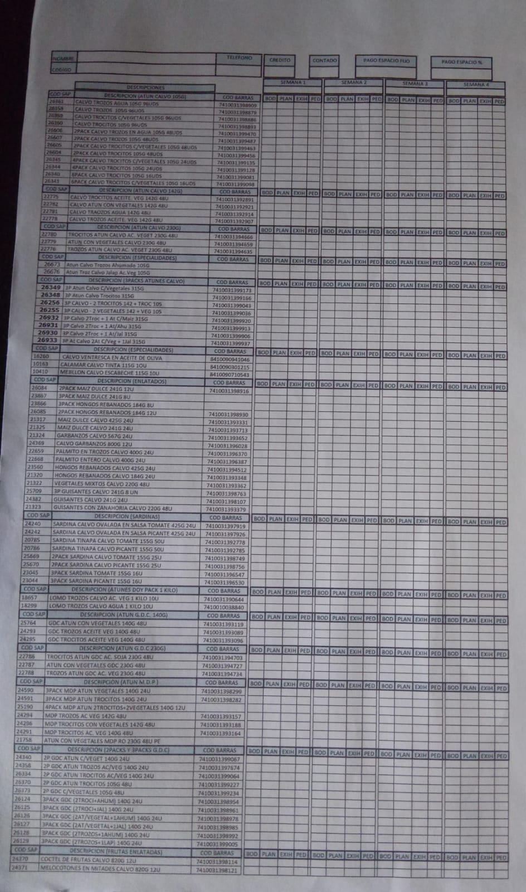
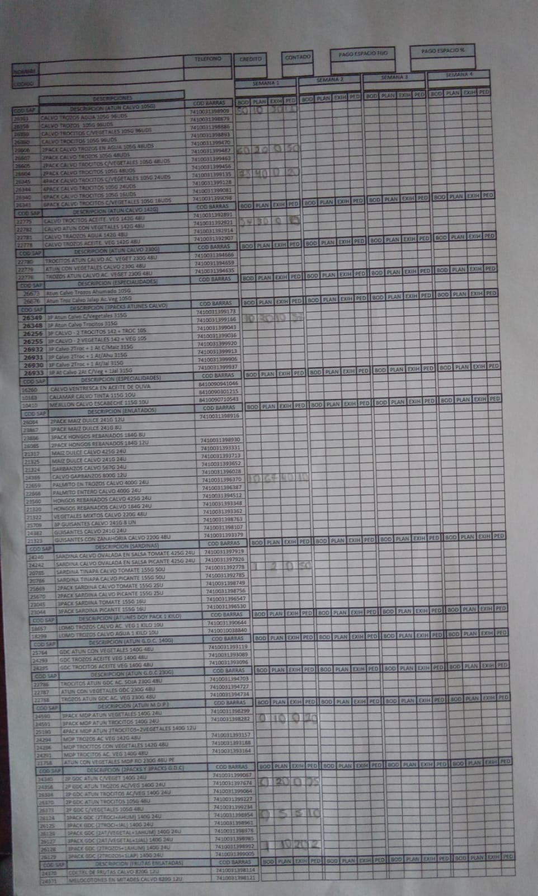

# Contextualización del negocio de ventas

## 1. Contexto del negocio

El cliente es un agente de ventas que trabaja para una empresa de productos enlatados. Su función es explorar distintos puntos de venta con el objetivo de vender la mayor cantidad de productos y/o cumplir con su cuota mensual de ventas. Los productos que ofrece principalmente son atunes y sardinas para abarroterías y supermercados de escala pequeña, mediana y grande.

Como parte de sus labores, visita **puntos de venta (PV)** para ofrecer sus productos. En cada PV explora las instalaciones para observar la cantidad y variedad de productos que maneja el dueño del local. Luego, realiza una recomendación para el pedido que el dueño del PV podría realizar, con la posibilidad de modificar dicha propuesta para cubrir sus necesidades y preferencias.

Se utilizan las **notas de crédito (NC)** como estrategia de ventas. Una NC consiste en un descuento aplicado a cada unidad que compra el dueño del negocio, y este varía dependiendo de la cantidad de productos que se soliciten a la empresa.

Otra actividad que forma parte de sus responsabilidades es agregar nuevos puntos de venta, impulsando el crecimiento de su ruta de ventas. Esto ayuda a facilitar el cumplimiento del monto objetivo de ventas establecido para cada mes.

### 1.1. Pasos realizados por el agente de ventas

1. **Análisis del Cardex**

   Es el proceso en el cual el agente de ventas explora las instalaciones y anota los productos con los que cuenta el local. Registra información como la cantidad de productos en **bodega (BOD)**, en **planta (PLAN)**, que corresponde a los productos ubicados en los estantes, y en **exhibición (EXIH)**, que corresponde a productos ubicados en lugares específicos dentro de las instalaciones distintos de los estantes habituales.

   Con la información anterior, el agente realiza un análisis para elaborar su recomendación de pedido para el dueño del negocio.

   

   

   

2. **Generación de la lista de pedido recomendado**

   Con la información resultante del proceso anterior, se visualiza la lista de pedido recomendado de una forma descentralizada y con datos irrelevantes para concretar la negociación.

   

   

   

3. **Generación de la nota de crédito**

   Como parte de la negociación, el agente de ventas puede recurrir a una NC para lograr que el dueño del establecimiento compre lo que se le recomienda o incluso compre una cantidad mayor. Para ello, se muestran los beneficios de comprar las cantidades ofrecidas, utilizando cálculos aproximados de utilidad y del ahorro que obtiene mediante la NC.

   

   

   

4. **Formalización del pedido con un recibo**

   Cuando se ha llegado a un acuerdo durante la negociación, el agente de ventas procede a formalizar el pedido mediante una lista con la información recopilada en los pasos anteriores.

   

   

   

## 2. Descripción del problema

Actualmente, las labores de registro de información, realización de cálculos y adición de nuevos puntos de venta son realizadas por los agentes de ventas de la empresa de productos enlatados mediante materiales físicos, como formularios impresos, recibos y calculadoras. Estos procesos manuales aumentan la posibilidad de inconsistencias en la información almacenada y también dificultan la trazabilidad y recuperación de la misma.

Debido a que los agentes de ventas necesitan mantener su información ordenada y disponible, los procesos manuales y la recopilación de información mediante medios físicos sin automatización disminuyen su eficiencia. Esto afecta directamente la negociación, ya que en muchas ocasiones se utilizan datos aproximados, lo que puede comprometer la credibilidad del agente de ventas.

Además, la falta de centralización de la información dificulta su extracción y disponibilidad. Por ejemplo, si el vendedor quisiera consultar el historial de compras de un local, tendría que buscar en documentos antiguos que posiblemente ya no conserve debido a pérdida o deterioro. Esto aumenta el trabajo desorganizado y repetitivo.

## 3. Justificación

El proceso actual de gestión de ventas depende en gran medida de registros físicos, cálculos manuales y la consulta de información almacenada en diferentes documentos. Esta forma de trabajo dificulta la disponibilidad y trazabilidad de la información, aumenta la posibilidad de inconsistencias en los registros y obliga al agente de ventas a realizar tareas repetitivas durante su jornada.

Esta situación también puede afectar el proceso de negociación, debido a que el agente necesita disponer de información precisa sobre los productos, cantidades y beneficios asociados a una propuesta de compra. De acuerdo con lo expresado por el cliente durante el levantamiento de información, contar con datos correctamente calculados y presentados de forma clara permitiría respaldar la negociación con información más precisa en lugar de recurrir a aproximaciones.

Por lo anterior, se identifica una oportunidad para centralizar y digitalizar la información utilizada durante el proceso de ventas, facilitando su registro, consulta y procesamiento. La solución propuesta busca reducir la dependencia de procesos manuales, mejorar la disponibilidad de la información y proporcionar al agente herramientas que le permitan desarrollar sus actividades de manera más organizada y eficiente.

## 4. Objetivos

### 4.1. Objetivo general

Desarrollar una aplicación móvil que permita digitalizar y centralizar la información utilizada por el agente de ventas durante la gestión de los puntos de venta, facilitando el registro, consulta y procesamiento de la información necesaria para apoyar el proceso de ventas.

## 4.2. Objetivos específicos

* Analizar y estructurar la información utilizada actualmente por el agente de ventas durante la gestión de los puntos de venta, con el propósito de identificar los datos y procesos que deben ser incorporados a la solución.

* Implementar un mecanismo centralizado para el registro y consulta de los puntos de venta y la información asociada a sus procesos de compra.

* Digitalizar el flujo utilizado para el análisis del inventario del punto de venta, la generación de pedidos recomendados y la aplicación de notas de crédito.

* Automatizar los cálculos necesarios para presentar al agente y al punto de venta información precisa durante el proceso de negociación.

## 5. Alcance

### 5.1. Incluido

1. Manejo de sesiones y perfiles.

2. Persistencia de los datos registrados.

3. Interfaz y experiencia de usuario optimizada para dispositivos móviles.

4. Compatibilidad con dispositivos Android e iOS.

5. Dashboard de usuario.

6. Módulo de centralización de puntos de venta asociados al agente de ventas.

7. Módulo que permita al agente de ventas registrar un nuevo punto de venta.

8. Módulo de centralización y flujo del Cardex, pedido recomendado, aplicación opcional de una NC y visualización de beneficios para apoyar la negociación.

9. Posibilidad de descargar en formato PDF los detalles del pedido para obtener un respaldo adicional de la información.

10. Implementación de pruebas que validen la calidad de la solución durante todo el ciclo de desarrollo.

11. Documentación de la solución durante todo el ciclo de desarrollo.

12. Automatización de CI/CD.

13. Despliegue de la aplicación.

### 5.2. Fuera del alcance

1. Permisos por roles.

2. Posibilidad de realizar el pedido desde la aplicación.

3. Análisis avanzado de la información recolectada.

## 6. Stakeholders principales

1. Agentes de ventas.

## 7. Stakeholders indirectos

1. Puntos de venta.

## 8. Descripción general de la solución esperada

La solución propuesta consiste en una aplicación móvil dirigida al agente de ventas de una empresa de productos enlatados, cuyo propósito es centralizar y digitalizar la información utilizada durante la gestión de los puntos de venta.

La aplicación permitirá al agente registrar y consultar la información de sus puntos de venta, realizar el análisis de los productos disponibles, generar recomendaciones de pedido y gestionar los elementos utilizados durante la negociación, como las notas de crédito. De esta manera, se busca reducir la dependencia de registros físicos y cálculos manuales, facilitando el acceso a información organizada y correctamente procesada durante el proceso de ventas.